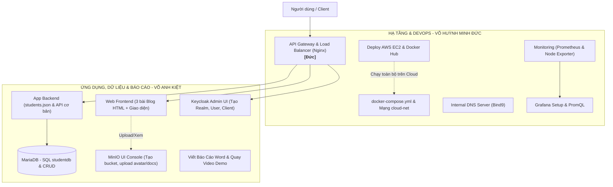
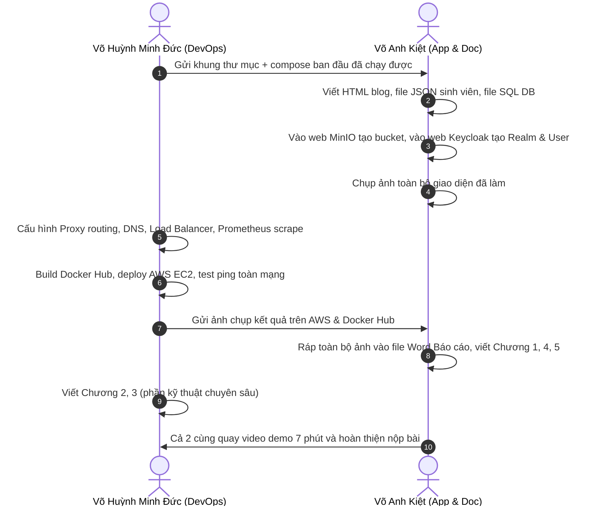

# BẢNG PHÂN CÔNG NHIỆM VỤ ĐỒ ÁN CUỐI KỲ (TỐI ƯU CHO TEAM)
## ĐỀ TÀI: XÂY DỰNG MÔ PHỎNG HỆ THỐNG MINICLOUD CƠ BẢN (MyMiniCloud)

---

## I. ĐỊNH HƯỚNG PHÂN CHIA (DỰA TRÊN THỰC TẾ NĂNG LỰC)

Do **Võ Anh Kiệt** chưa rành về DevOps, hạ tầng mạng và Linux/Cloud, nếu giao các server hạ tầng (như Bind9, Load Balancer, Prometheus, AWS EC2) sẽ rất dễ bị ngợp và gây tắc nghẽn tiến độ đồ án.

Nhóm sẽ áp dụng mô hình phân vai thực tế và ăn ý:
- **Võ Huỳnh Minh Đức (DevOps & Infrastructure Lead):** Đảm nhiệm toàn bộ phần "xương sống" kỹ thuật: Docker Compose, Mạng nội bộ, API Gateway, Load Balancer, DNS, Prometheus/Grafana, Docker Hub và Triển khai AWS EC2.
- **Võ Anh Kiệt (Application, Content & Documentation Lead):** Đảm nhiệm các phần thiên về **Giao diện Web, Nội dung tĩnh, Thao tác UI trên trình duyệt (Web Console), Dữ liệu mẫu & Soạn thảo báo cáo Word**.

> [!TIP]
> Các thao tác của Kiệt chủ yếu là viết code HTML/CSS, JSON, SQL cơ bản và thao tác chuột trực quan trên Web UI (MinIO Console, Keycloak Admin Console), không cần can thiệp sâu vào dòng lệnh Linux hay hạ tầng mạng phức tạp.

---

## II. MA TRẬN PHÂN CHIA CHI TIẾT



---

## III. BẢNG PHÂN CÔNG CỤ THỂ CHO TỪNG BẠN

### 👤 1. VÕ HUỲNH MINH ĐỨC (Phụ trách DevOps, Mạng & Hạ tầng Cloud)

| STT | Module kỹ thuật | Nhiệm vụ cụ thể | Mục tiêu mở rộng đạt điểm |
| :---: | :--- | :--- | :--- |
| **1** | **Khung dự án & Docker Compose** | • Viết toàn bộ `docker-compose.yml` tích hợp 10 containers + network `cloud-net`.<br>• Cấu hình volume, port, restart policy, depends_on chuẩn xác. | Khung chuẩn cho toàn bộ hệ thống |
| **2** | **API Gateway & Reverse Proxy** | • Viết file `nginx.conf` cho Gateway port 80.<br>• Định tuyến routing: `/` $\rightarrow$ Web, `/api/` $\rightarrow$ App, `/auth/` $\rightarrow$ Keycloak.<br>• **Mở rộng 9:** Cấu hình route `/student/` trỏ tới App Backend. | **0.5 đ** (Mở rộng 9) |
| **3** | **Load Balancer (Cân bằng tải)** | • Dựng 2 instance Web: `web-frontend-server1` và `web-frontend-server2`.<br>• **Mở rộng 10:** Cấu hình upstream Round Robin trong Nginx, test luân phiên. | **0.5 đ** (Mở rộng 10) |
| **4** | **Internal DNS Server (Bind9)** | • Cấu hình Bind9 với zone `cloud.local`.<br>• **Mở rộng 6:** Thêm bản ghi A cho app-backend, minio, keycloak trong `db.cloud.local`, test bằng lệnh `dig`. | **0.5 đ** (Mở rộng 6) |
| **5** | **Prometheus & Grafana (Setup)** | • Viết cấu hình `prometheus.yml` scrape Node Exporter.<br>• **Mở rộng 7:** Thêm target scrape `web-frontend-server:80` vào Prometheus.<br>• Hỗ trợ cấu hình Datasource Prometheus trên Grafana, viết câu lệnh PromQL cho 3 biểu đồ (CPU, RAM, Network). | **1.0 đ** (Mở rộng 7 & 8) |
| **6** | **Tích hợp Backend nâng cao** | • Hỗ trợ Kiệt phần code xác thực OIDC JWT tại `/secure` trong Node.js (Express).<br>• Viết endpoint kết nối MariaDB `/students-db`. | Hoàn thiện luồng bảo mật |
| **7** | **Đóng gói Docker Hub & Triển khai AWS EC2** | • Build & push custom image lên Docker Hub.<br>• Tạo máy ảo AWS EC2 Ubuntu, cấu hình Security Group mở ports.<br>• Chạy toàn bộ hệ thống trên EC2 qua Public IP thực tế và test ping 10 containers. | *Yêu cầu bắt buộc của đồ án* |
| **8** | **Báo cáo đảm nhiệm** | • Viết **Chương 2** (Kiến trúc & Sơ đồ Network/Request flow).<br>• Viết **Chương 3** (Trình bày chi tiết Dockerfile, Docker Compose, Nginx config, DNS config, Prometheus config). | Hoàn thành tài liệu kỹ thuật |

---

### 👤 2. VÕ ANH KIỆT (Phụ trách Giao diện, Ứng dụng, Thao tác UI & Báo cáo)

*Mọi công việc của Kiệt đều có hướng dẫn thao tác trực quan (UI, gõ HTML/SQL đơn giản hoặc click chuột trên Web), không đòi hỏi kiến thức dòng lệnh Linux.*

| STT | Module phụ trách | Nhiệm vụ cụ thể (Rất dễ làm) | Mục tiêu mở rộng đạt điểm |
| :---: | :--- | :--- | :--- |
| **1** | **Web Frontend & Blog** | • Viết trang chủ `index.html` và trang `blog/index.html`.<br>• **Mở rộng 1:** Viết 3 bài blog HTML (`blog1.html`, `blog2.html`, `blog3.html`) theo chủ đề tự chọn (công nghệ, sở thích...), chèn ảnh đẹp mắt, gắn link quay lại trang chủ. | **0.5 đ** (Mở rộng 1) |
| **2** | **App Backend & Dữ liệu Sinh viên** | • Tạo file `students.json` chứa thông tin 5 sinh viên mẫu (id, name, major, gpa).<br>• **Mở rộng 2:** Viết endpoint Node.js/Express đơn giản `app.get("/student")` đọc file JSON và trả về `res.json()`. | **0.5 đ** (Mở rộng 2) |
| **3** | **Database MariaDB (SQL)** | • Viết file SQL khởi tạo `studentdb`.<br>• **Mở rộng 3:** Viết câu lệnh `CREATE TABLE students` và lệnh `INSERT INTO` 3-5 bạn sinh viên thực tế, viết truy vấn SELECT kiểm tra. | **0.5 đ** (Mở rộng 3) |
| **4** | **Keycloak (Thao tác trên Web UI)** | • Mở trình duyệt `http://localhost:8081` đăng nhập admin/admin.<br>• **Mở rộng 4:** Tạo Realm mới theo MSSV (`realm_VoAnhKiet`), tạo 2 user (`sv01`, `sv02`), tạo client `flask-app`. Chụp lại từng bước làm ảnh minh chứng. | **0.5 đ** (Mở rộng 4) |
| **5** | **MinIO (Thao tác trên Web UI)** | • Mở trình duyệt `http://localhost:9001` đăng nhập `minioadmin / minioadmin`.<br>• **Mở rộng 5:** Bấm nút tạo bucket `profile-pics` $\rightarrow$ upload ảnh avatar; tạo bucket `documents` $\rightarrow$ upload file PDF. Lấy link chia sẻ public. Chụp màn hình minh chứng. | **0.5 đ** (Mở rộng 5) |
| **6** | **Grafana Dashboard (Thao tác trên Web UI)** | • Mở trình duyệt `http://localhost:3000` đăng nhập admin/admin.<br>• Tạo dashboard mới tên `System Health of <MSSV>`, add 3 panel biểu đồ CPU, RAM, Network (Đức cung cấp sẵn tên metric PromQL, Kiệt chỉ cần paste vào và chỉnh màu biểu đồ). | Đạt chuẩn minh chứng |
| **7** | **Tổng hợp Báo cáo & Video Demo** | • **Chương 1:** Giới thiệu đề tài, mục tiêu, bảng phân công nhiệm vụ.<br>• **Chương 4:** Chèn toàn bộ ảnh chụp kết quả kiểm thử (Web blog, API JSON, Database, Keycloak, MinIO, Grafana dashboard, Ping).<br>• **Chương 5 & Phụ lục:** Viết ưu/nhược điểm, kinh nghiệm rút ra, link Docker Hub, link video demo.<br>• **Quay Video:** Quay màn hình demo các tính năng giao diện (Blog, MinIO, Keycloak, Grafana) và ghép video demo hoàn chỉnh. | *Đảm bảo hình thức báo cáo chỉn chu* |

---

## IV. BẢNG HƯỚNG DẪN NHANH DÀNH CHO KIỆT (CHEAT SHEET)

Để Kiệt không bị bỡ ngỡ, Đức chỉ cần gửi cho Kiệt các mẫu này:

1. **Với Web Blog:** Kiệt chỉ cần soạn 3 file HTML trong thư mục `web-frontend-server/html/blog/`, thêm ít ảnh `.jpg` là xong.
2. **Với API Node.js/Express (`students.json`):**
   ```json
   [
     {"id": "01", "name": "Võ Huỳnh Minh Đức", "major": "Cloud Computing", "gpa": 3.8},
     {"id": "02", "name": "Võ Anh Kiệt", "major": "Software Engineering", "gpa": 3.7}
   ]
   ```
3. **Với Database (`init.sql`):**
   ```sql
   CREATE DATABASE IF NOT EXISTS studentdb;
   USE studentdb;
   CREATE TABLE students (
       id INT AUTO_INCREMENT PRIMARY KEY,
       student_id VARCHAR(10),
       fullname VARCHAR(100),
       dob DATE,
       major VARCHAR(50)
   );
   INSERT INTO students (student_id, fullname, dob, major) VALUES
   ('20110001', 'Võ Huỳnh Minh Đức', '2003-01-01', 'Cloud Computing'),
   ('20110002', 'Võ Anh Kiệt', '2003-02-02', 'Software Engineering');
   ```
4. **Với MinIO & Keycloak:** Hoàn toàn click chuột trên trình duyệt, Kiệt chỉ việc làm theo từng bước và chụp lại màn hình sắc nét để đưa vào báo cáo Word.

---

## V. TIẾN ĐỘ THỰC HIỆN 4 BƯỚC ĂN Ý



---

## VI. TỔNG KẾT

Cách phân chia này giải quyết triệt để vấn đề:
1. **Kiệt không bị áp lực về DevOps:** Kiệt tập trung vào những việc thân thiện (HTML, JSON, SQL, click Web UI và làm file báo cáo Word/Video).
2. **Đức nắm quyền chủ động hạ tầng:** Đức quản lý toàn bộ Docker, Nginx, DNS, Monitoring và AWS EC2 để tránh lỗi cấu hình chéo.
3. **Đảm bảo 100% điểm tối đa (10/10):** Không bỏ sót bất kỳ tiêu chí nào trong 10 mục mở rộng và yêu cầu cloud của giảng viên.
